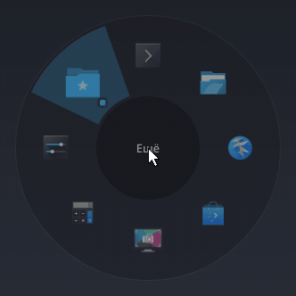
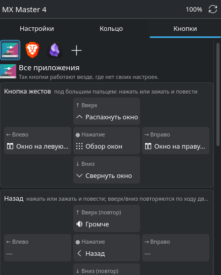
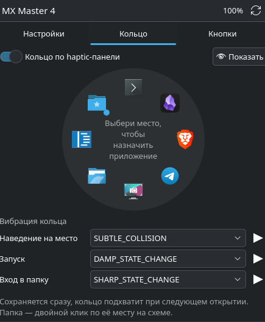
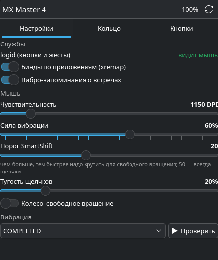

# MX Master 4 для KDE Plasma (CachyOS / Arch)

[English version](README.md)

Logi Options+ на Linux нет. Этот проект переносит самое полезное из него в KDE Plasma 6 на Wayland
для мыши **Logitech MX Master 4**:

- **Кнопки по приложениям — мышкой.** Виджет на панели показывает все кнопки и жесты: кнопку жестов,
  «назад» и «вперёд» (у каждой нажатие и 4 направления), haptic-панель, кнопку за колесом, боковое
  колесо. Клик по плитке — выбрать действие из каталога с поиском: вкладки, окна, звук, правка,
  запуск приложения, сочетание клавиш, любое глобальное действие KDE. Профиль для любого приложения —
  в один клик. Применяется сразу: без конфигов и без sudo.
- **Кольцо действий.** Нажатие на haptic-панель открывает вокруг курсора кольцо из 8 приложений.
  На каждом новом месте мышь коротко «щёлкает» под большим пальцем. Места могут быть папками.
  Раскладка — в виджете.
- **Настройки мыши.** Заряд, DPI, сила вибрации, порог и тугость SmartShift, свободное вращение —
  напрямую по HID++.
- **Вибро-уведомления** откуда угодно: `mouse-buzz COMPLETED` (16 встроенных сигналов). Примеры для
  хуков Claude Code и fish — в `extras/`. Выключение микрофона с мыши отвечает разной вибрацией.

<p align="center">
  
</p>

<p align="center">
  
  
  
</p>

Интерфейс на английском.

## Что нужно

- CachyOS или другой дистрибутив на основе Arch, KDE Plasma 6 на **Wayland**
  (проверено: CachyOS, Plasma 6.7.5, xremap 0.15.15, logiops-git 0.3.5)
- MX Master 4 через **приёмник Logi Bolt (или Unifying)**. По Bluetooth кнопки работают, а заряд, DPI
  и вибрация в виджете — нет (HID++ идёт через приёмник).
- Пакеты (установщик предложит поставить недостающие): `logiops-git`, `xremap-kde-bin` (AUR),
  `python-pyqt6`, `python-yaml`, `python-dbus`, `layer-shell-qt`, `qt6-tools`, `wireplumber`

## Установка

```sh
git clone https://github.com/anttelouder/mx-master-4-kde-cachy.git ~/git/mx-master-4-kde-cachy
cd ~/git/mx-master-4-kde-cachy
./install.sh
```

Затем правый клик по панели → «Добавить виджеты…» → **MX Master 4**.
Если кнопки не реагируют — выключи и включи мышь переключателем снизу (logiops с приёмником Bolt
иногда не видит уже подключённую мышь после перезапуска).

Репозиторий — единственный источник: `~/.local/bin/*` и виджет — ссылки в него, поэтому `git pull`
обновляет всё (кольцо перезапустить: `systemctl --user restart actions-ring`).

Удаление: `./uninstall.sh` (настройки в `~/.config` остаются).

## Как устроено

```
мышь ─┬─► logiops (logid, /etc/logid.cfg — не меняется)
      │     каждая кнопка и жест → своя «пустая» клавиша (F13–F24, KEY_FN_F1–F5) ─► «LogiOps Virtual Input»
      └─ сама мышь (движение, колёса) ───────────────────────────────────────────────────┤
                                                                                         ▼
               xremap (служба пользователя, ~/.config/xremap/config.yml — пишет виджет)
                     → действие из профиля активного приложения или «Всех приложений»
```

| Часть | Что делает |
|---|---|
| `config/logid.cfg` | Каждой кнопке и жесту — своя «пустая» клавиша. Больше не правится. |
| `buttons.py` | Модель: кнопки → клавиши, каталог действий, стандартная раскладка, чтение и запись конфига xremap. |
| `mousectl.py` | Бэкенд виджета: состояние, настройки по HID++, бинды, кольцо. Ответы в JSON. |
| `hidpp.py` | Минимальный клиент HID++ 2.0 (заряд, DPI, SmartShift, вибрация). Межпроцессная блокировка — приёмник делят несколько программ. |
| `actions-ring/` | Кольцо: оверлей PyQt6/QML на layer-shell, активное окно сообщает KWin-скрипт по D-Bus. |
| `plasmoid/` | Виджет Plasma. |
| `mouse-buzz.py`, `mic-buzz.sh` | Вибро-сигнал из командной строки; отклик после переключения микрофона. |

Ограничения: жесты срабатывают на отпускании кнопки, поэтому удержание боковых кнопок (push-to-talk)
пока невозможно; сочетания с Meta KWin перехватывает раньше кнопки «Записать» — их нужно вписать
текстом (`Super-w`).

## Благодарности

[logiops](https://github.com/PixlOne/logiops), [xremap](https://github.com/xremap/xremap)
и [Solaar](https://github.com/pwr-Solaar/Solaar) как справочник по протоколу HID++.

## Лицензия

MIT
